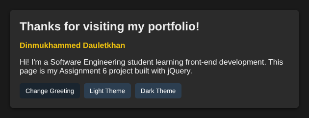
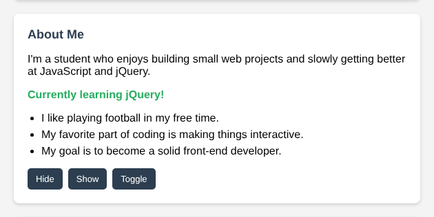
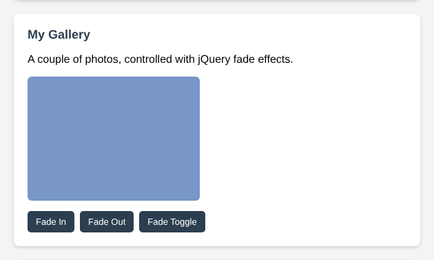
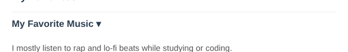
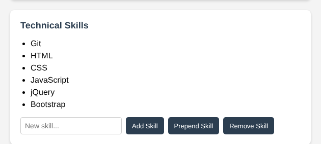
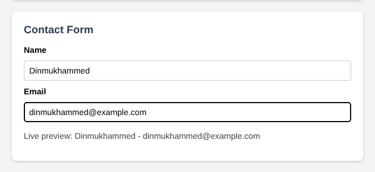
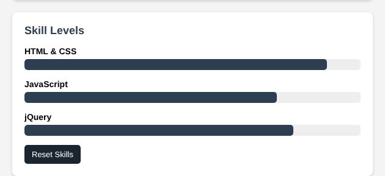

# Assignment 6 - jQuery (Selectors, Effects, Animations)

**Name:** Dinmukhammed Dauletkhan
**Group:** SE-2538

GitHub Pages link: [add your github.io link here after you enable Pages]

## Part 1. Getting Started with jQuery (Task 0-1)
jQuery is loaded from a CDN and wrapped in `$(document).ready()`, which logs "jQuery is ready!" to the console. The profile section uses tag (`h2`), id (`#headline`) and class selectors. The "Change Greeting" button swaps the headline text with `.text()`, and the Light/Dark Theme buttons toggle a CSS class that restyles the page with `.css()`/`.addClass()`/`.removeClass()`.

Screenshot (dark theme + updated greeting):

## Part 2. jQuery Effects

### Task 2 - Visibility Methods
An "About Me" section with a status message and a fun facts list. The Hide / Show / Toggle buttons control their visibility with `.hide()`, `.show()` and `.toggle()`.

Screenshot:

### Task 3 - Fade Methods
A small gallery with two images. Fade In / Fade Out / Fade Toggle buttons use `.fadeIn()`, `.fadeOut()` and `.fadeToggle()`.

Screenshot (second image faded out):

### Task 4 - Slide Methods
Three clickable headings ("My Favorite Music", "My Favorite Movie", "My Favorite Subject"), each with a hidden panel underneath that opens with `.slideToggle()` when the heading is clicked.

Screenshot (one panel open):

## Part 3. DOM Manipulation with jQuery

### Task 5 - Add & Remove Elements
A list of technical skills. "Add Skill" appends a new `<li>` with `.append()`, "Prepend Skill" adds it to the top with `.prepend()`, and "Remove Skill" deletes the last item with `.remove()`. Empty input is ignored so blank skills can't be added.

Screenshot (after adding and prepending a skill):

### Task 6 - Modifying Attributes
A social media link that starts pointing to GitHub. The button changes its destination and label using `.attr()`.

Screenshot (after switching to LinkedIn):

### Task 7 - Form Interaction
A form with Name and Email fields. As the user types, `.val()` reads the input and `.text()` displays it live below the form.

Screenshot:

## Part 4. Animations

### Task 8 - Basic Animation
Three skill bars (HTML & CSS, JavaScript, jQuery) that start at zero width. The "Animate My Skills" button uses `.animate()` to grow each bar to a different target width, and clicking it again animates them back to zero.

Screenshot (after animating):

## Summary
This assignment helped me see how much shorter jQuery makes common DOM tasks compared to plain JavaScript - selecting elements with `$()` and chaining methods like `.fadeOut()` or `.slideToggle()` takes one line instead of several. The effects section (Task 2-4) was the easiest since the methods basically do what their names say. Task 5 took a bit more care because I had to remember to check for an empty input before calling `.append()`/`.prepend()`, otherwise empty list items would get added. The animation part (Task 8) was interesting - `.animate()` needed a plain object with the CSS property to change, and I had to keep track of a boolean flag so the same button could animate the bars forward and then back to zero on the next click. Overall, working through visibility, fade, slide, DOM manipulation and animation in one project gave me a much clearer picture of what jQuery is actually useful for.
